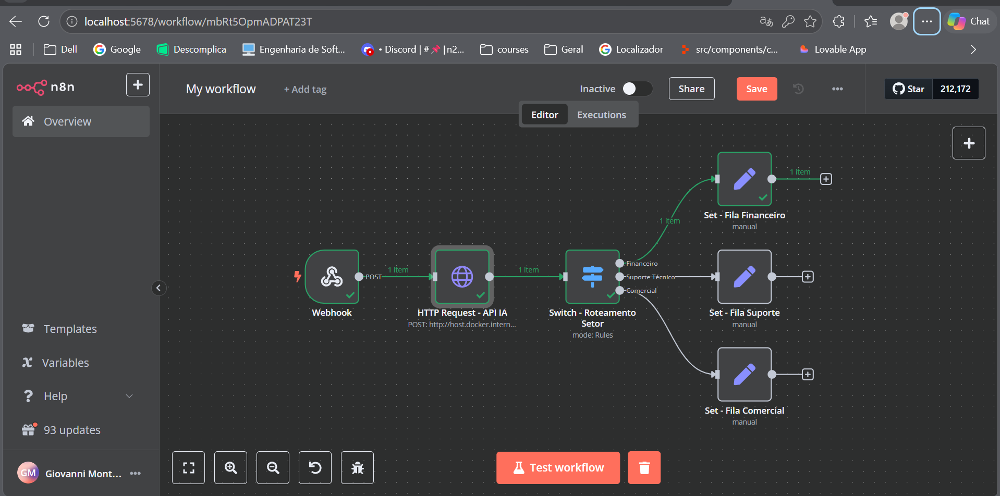
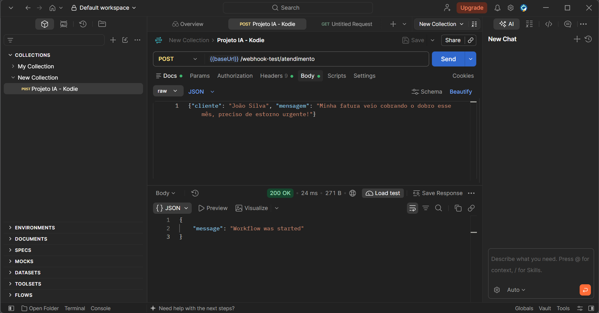
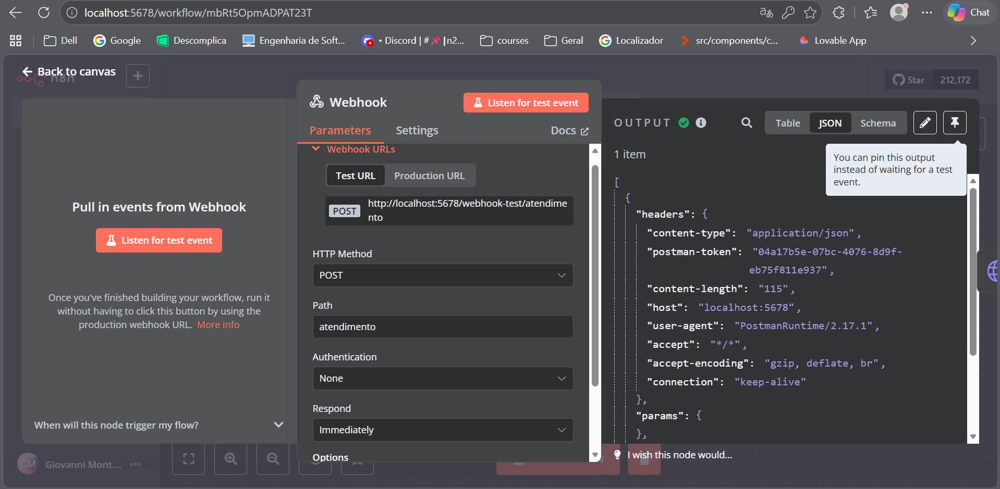
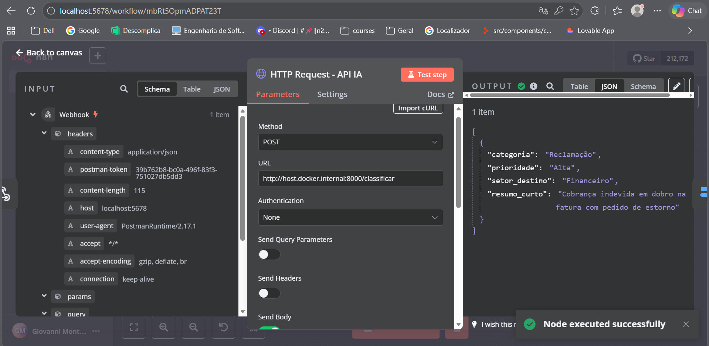
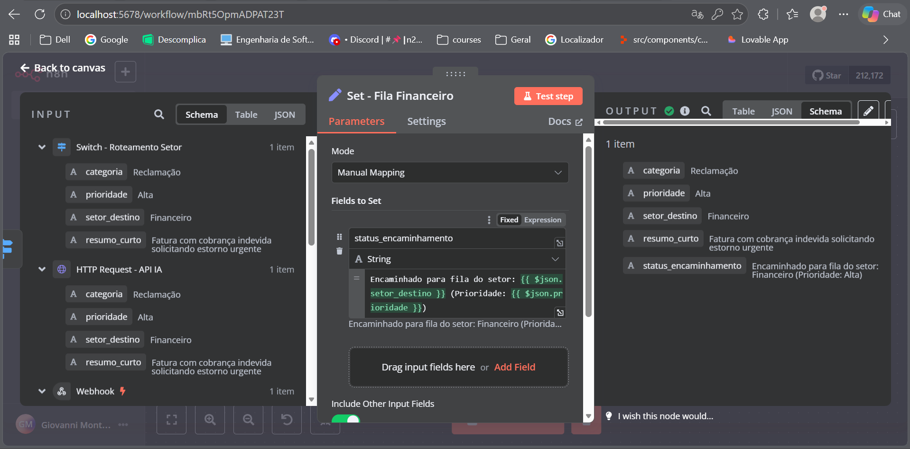
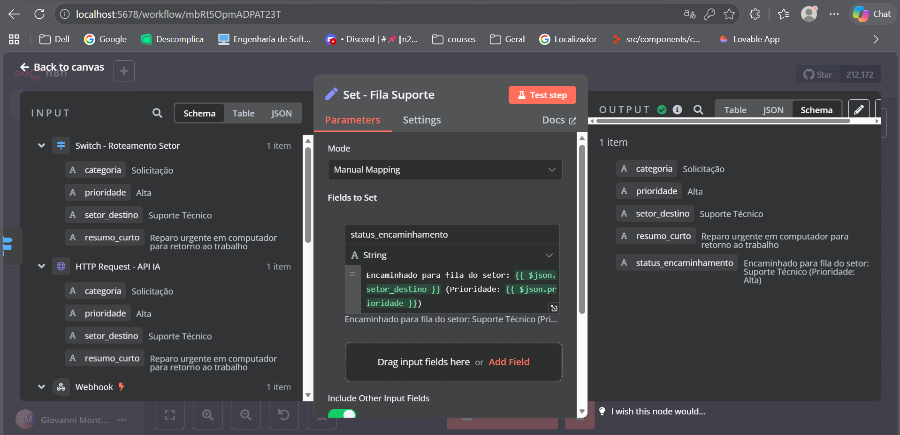
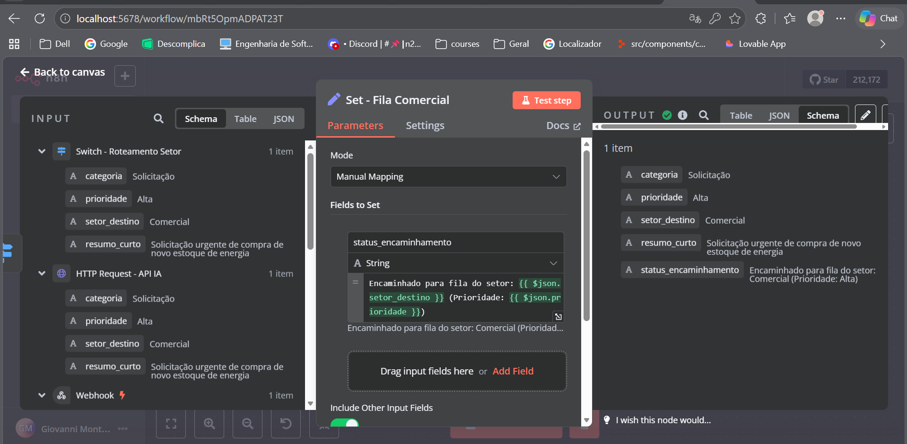
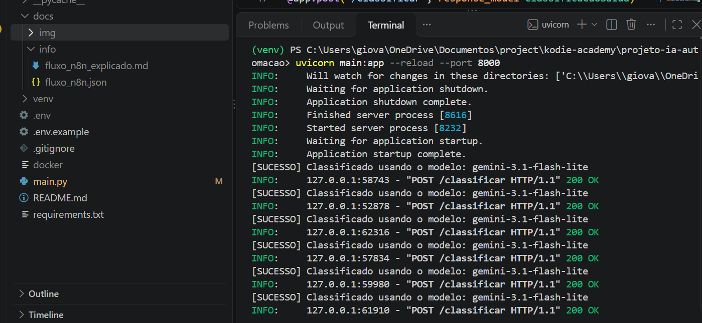
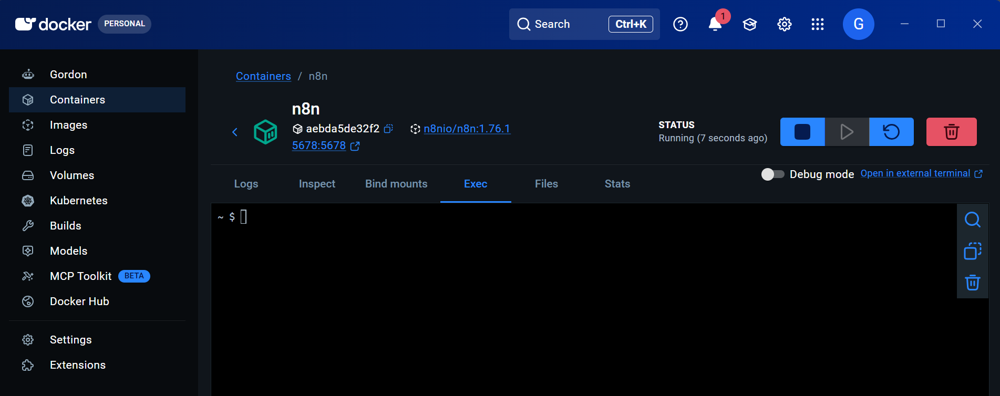
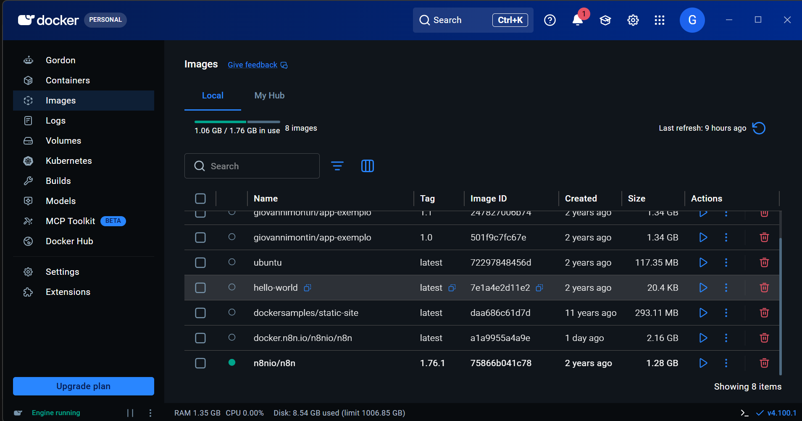

# Classificador Inteligente de Mensagens de Atendimento

Solução de Inteligência Artificial e Automação desenvolvida como projeto integrador para triagem, classificação e roteamento automático de mensagens de clientes.

---

## Fluxo N8N
1. Um **Webhook** no n8n recebe a mensagem do cliente em formato JSON.
2. O fluxo envia os dados para uma **API REST em Python (FastAPI)**, que aplica engenharia de prompt estruturada e utiliza o modelo **Google Gemini** com *Structured Outputs* (validado via Pydantic) para classificar a mensagem estritamente em JSON (`categoria`, `prioridade`, `setor_destino` e `resumo_curto`).
3. O **n8n** interpreta o retorno da IA e utiliza um roteador condicional (**Switch**) para encaminhar automaticamente o atendimento à fila do departamento correspondente (`Financeiro`, `Suporte Técnico` ou `Comercial`).

## Funcionamento do Sistema

### Arquitetura e Fluxo de Dados
```text
──▶ [1. Webhook (POST)] 
──▶ [2. HTTP Request (FastAPI + Gemini)] 
──▶ [3. Switch (Setor)] 
──┬──▶ [4A. Set - Financeiro]
  ├──▶ [4B. Set - Suporte Técnico]
  └──▶ [4C. Set - Comercial]
```

1. **Recepção (API FastAPI):** O endpoint `POST /classificar` recebe um payload JSON contendo `cliente` e `mensagem`, valida os tipos de entrada com Pydantic e injeta os dados em um prompt com regras estritas de classificação.

2. **Processamento com IA:** O modelo `gemini-2.5-flash` analisa o contexto da mensagem com baixa temperatura (`0.1`) e retorna um objeto JSON garantido pelo schema `ClassificacaoSaida`.

3. **Execução da Automação (n8n):** O fluxo escuta chamadas externas no Webhook `/atendimento`, consulta a API local (`http://localhost:8000/classificar`), avalia o campo `setor_destino` no node *Switch* e registra o encaminhamento na fila do setor específico.

---

### Documentação Visual e Explicação Técnica dos Nodes

O workflow está descrito em [`fluxo_n8n.json`](./fluxo_n8n.json). A sequência é **Postman → Webhook do n8n → API FastAPI/Gemini → Switch → Set do setor**. O Postman chama o Webhook do n8n; é o node HTTP Request que, em seguida, chama a API de classificação.



#### 1. Envio da requisição pelo Postman

No Postman, use o método `POST` e a URL do Webhook de teste:

```text
http://localhost:5678/webhook-test/atendimento
```

O caminho `/webhook-test/` é usado enquanto o workflow está aguardando uma execução de teste no editor do n8n. Para um workflow ativo, usa-se a URL de produção `/webhook/atendimento`. Envie o corpo como JSON, com `Content-Type: application/json` e os campos esperados pelo endpoint:

```json
{
  "cliente": "João Silva",
  "mensagem": "Minha fatura veio cobrando o dobro esse mês, preciso de estorno urgente!"
}
```



#### 2. Recebimento pelo Webhook

O node `Webhook` (`n8n-nodes-base.webhook`) é o gatilho de entrada. Ele recebe o `POST` no path `atendimento` e disponibiliza o corpo recebido em `$json.body`; por isso, os campos são lidos como `$json.body.cliente` e `$json.body.mensagem`. A porta `5678` pertence ao n8n, não à API FastAPI.



#### 3. Chamada à API e classificação

O node `HTTP Request - API IA` (`n8n-nodes-base.httpRequest`) envia uma segunda requisição `POST`, agora para o endpoint FastAPI `/classificar`. Como o n8n está em Docker e a API está acessível no host, a URL prevista na configuração é:

```text
http://host.docker.internal:8000/classificar
```

O node envia um corpo JSON usando os valores do Webhook:

```json
{
  "cliente": "{{ $json.body.cliente }}",
  "mensagem": "{{ $json.body.mensagem }}"
}
```

A API valida a entrada com `MensagemEntrada`, monta o prompt e solicita ao Gemini uma classificação estruturada. A resposta contém `categoria`, `prioridade`, `setor_destino` e `resumo_curto`; esses dados são então entregues ao Switch. **Observação:** no arquivo JSON do workflow, o valor do campo `url` está atualmente escrito com sintaxe de link Markdown, em vez de uma URL literal. Para executar o workflow importado, esse campo precisa conter apenas a URL acima.



#### 4. Roteamento pelo Switch

O node `Switch - Roteamento Setor` (`n8n-nodes-base.switch`) avalia `$json.setor_destino` e compara o resultado com `Financeiro`, `Suporte Técnico` e `Comercial`. O item segue pela saída correspondente ao valor recebido. Esse roteamento escolhe um ramo dentro do workflow; não envia, por si só, uma mensagem a uma fila ou sistema externo.

![Roteamento pelo Switch]
(../img/terceiro_passo_roteamento1.png)
(../img/terceiro_passo_roteamento2.png)
(../img/terceiro_passo_roteamento3.png)

#### 5. Preparação do resultado pelo node Set

Cada saída do Switch conecta ao node Set do respectivo setor. O Set mantém os campos recebidos (`includeOtherFields: true`) e adiciona `status_encaminhamento`, por exemplo:

```text
Encaminhado para fila do setor: Financeiro (Prioridade: Alta)
```

Esse campo registra o resultado do roteamento; os nodes Set não integram com um sistema de filas externo. A saída final do ramo contém os dados da classificação e o novo status, por exemplo:

```json
{
  "categoria": "Reclamação",
  "prioridade": "Alta",
  "setor_destino": "Financeiro",
  "resumo_curto": "Fatura com cobrança indevida solicitando estorno urgente",
  "status_encaminhamento": "Encaminhado para fila do setor: Financeiro (Prioridade: Alta)"
}
```

Os campos de classificação variam conforme a mensagem recebida. O resultado da execução pode ser conferido na saída do node Set executado:





#### Resposta recebida pelo Postman

No workflow atual, o Webhook usa a resposta padrão do n8n, que confirma o recebimento sem aguardar a conclusão dos nodes seguintes. Por isso, o Postman recebe uma confirmação HTTP — na captura, `200 OK` com `{"message":"Workflow was started"}` — e não o JSON final da classificação. O resultado final fica disponível nos dados da execução no n8n. Para devolver esse resultado ao cliente HTTP, o workflow precisa ser configurado para responder após os nodes finais, por exemplo, com um node `Respond to Webhook`.

![OutrasEvidencias]




---

## 6. Como Executar

### Pré-requisitos
* Python 3.10 ou superior
* Node.js 22 ou abaixo 26 (para execução local do n8n)
* Chave de API gratuita do Google AI Studio (`GEMINI_API_KEY`)

### Passo a Passo para Instalação e Execução

1. **Clone o repositório e acesse a pasta do projeto:**
   ```bash
   git clone https://github.com/GiovanniMontinOFC/classificador-mensagens-ia-automacao
   cd /classificador-mensagens-ia-automacao
   ```

2. **Crie e ative o ambiente virtual Python:**
   ```bash
   python -m venv venv
   # No Windows:
   venv\Scripts\activate
   # No Linux/Mac:
   source venv/bin/activate
   ```

3. **Instale as dependências da API:**
   ```bash
   pip install -r requirements.txt
   ```

4. **Configure as variáveis de ambiente:**
   * Copie o arquivo `.env.example` para um novo arquivo chamado `.env`:
     ```bash
     cp .env.example .env
     ```
   * Abra o arquivo `.env` e insira sua chave da API do Gemini:
     ```env
     GEMINI_API_KEY=sua_chave_api_aqui
     ```
   * Para ter sua chave de api, cadastre-se gratuitamente no site da ia do gemini, procure por Get API Key e comece sua jornada! 
   - Site: https://aistudio.google.com/

5. **Inicie o servidor da API FastAPI:**
   ```bash
   uvicorn main:app --reload --port 8000
   ```
   A API ficará disponível em `http://localhost:8000` (documentação interativa em `http://localhost:8000/docs`).

6. **Inicie o n8n e importe o fluxo:**
   * Em um segundo terminal, execute:
     ```bash
     npx n8n
     ```
   * Acesse `http://localhost:5678` no navegador, crie um novo workflow, clique no menu **`...` > Import from File...** e selecione o arquivo `fluxo_n8n.json` localizado na raiz deste repositório.

7. **Teste a integração:**
   * Clique em **Test Workflow** no n8n e envie uma requisição `POST` para `http://localhost:5678/webhook-test/atendimento` com o seguinte corpo JSON:
     ```json
     {
       "cliente": "João Silva",
       "mensagem": "Minha fatura veio cobrando o dobro esse mês, preciso de estorno urgente!"
     }
     ```